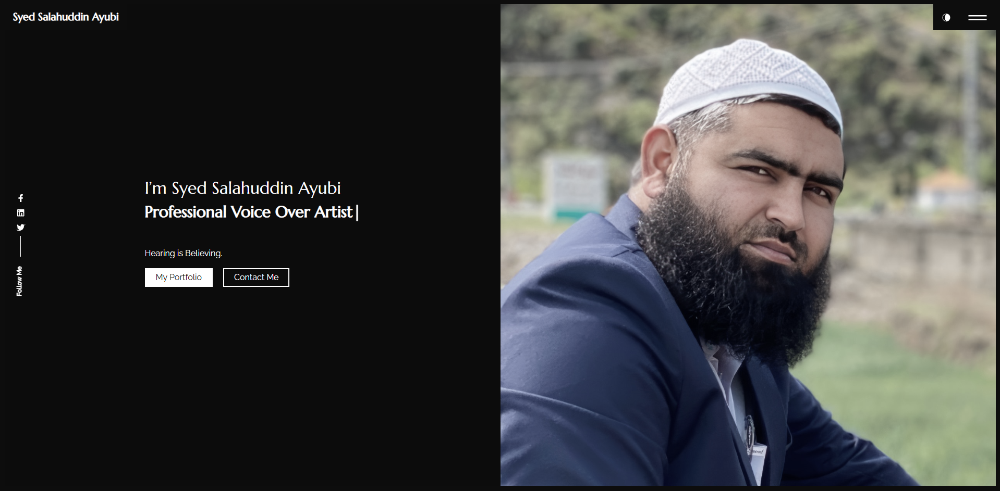

# Syed Salahuddin Ayubi - Professional Voice Over Portfolio

A professional, responsive portfolio website designed to showcase voice-over demos with an interactive audio experience. Built with React and WaveSurfer.js, this project emphasizes audio clarity, visual elegance, and seamless performance.



## 🎙️ Features

- **Interactive Waveform Player**: Visual audio playback using `wavesurfer.js` for a professional feel.
- **Countdown Timer**: Real-time remaining duration display (MM:SS) for track precision.
- **Theme Awareness**: Fully responsive Dark and Light modes with dynamic contrast adjustments.
- **Single Playback Logic**: Ensures only one audio track plays at a time for a clean listening experience.
- **Responsive Design**: Optimized for desktop, tablet, and mobile devices using Bootstrap 5.
- **Fast Performance**: Minimalist architecture with optimized assets.

## 🛠️ Tech Stack

- **Frontend**: [React.js](https://reactjs.org/) (v18)
- **Styling**: [Bootstrap 5](https://getbootstrap.com/), Custom CSS
- **Audio Visualization**: [WaveSurfer.js](https://wavesurfer-js.org/)
- **Routing**: React Router DOM (v6)
- **Icons**: React Icons (FontAwesome, etc.)
- **Animations**: Typewriter Effect, React Transition Group
- **Deployment**: Vercel Ready

## 🚀 Getting Started

Follow these steps to run the project locally.

### Prerequisites

- Node.js (v14 or higher)
- yarn

### Installation

1.  **Clone the repository** (or download source):
    ```bash
    git clone https://github.com/yourusername/salahuddin-portfolio.git
    cd salahuddin-portfolio
    ```

2.  **Install dependencies**:
    ```bash
    yarn install
    ```

3.  **Start the development server**:
    ```bash
    yarn dev
    ```

    Open [http://localhost:3000](http://localhost:3000) to view it in your browser.

## 📦 Build for Production

To create an optimized build for deployment:

```bash
yarn build
```

This creates a `build` folder with static assets ready for deployment.

## 🌐 Deployment to Vercel

1.  Install Vercel CLI or use the dashboard.
2.  Run `vercel` in the project root.
3.  Follow the prompts. The default settings for "Create React App" usually work out of the box.

## 👤 Author

**Sajawal Mirza**
*(Pro-Prompter)*

- **LinkedIn**: [Sajawal Mirza](https://www.linkedin.com/in/sajawalmirza/)
- **Email**: [mirzasajawal827@gmail.com](mailto:mirzasajawal827@gmail.com)

## 📄 License

This project is open source and available under the [MIT](LICENSE).
